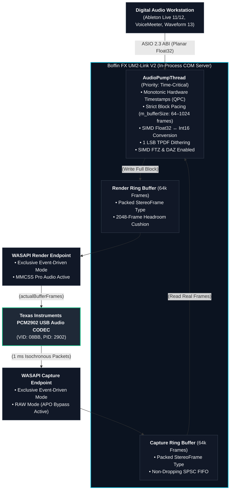

Boffin FX UM2-Link (Version 2.0.1)
-blue.svg)

Boffin FX UM2-Link V2 is a dedicated, user-mode ASIO 2.3 driver wrapper engineered from scratch in modern C++20 for Texas Instruments PCM2902-family USB class-compliant audio interfaces (including the popular Behringer U-Phoria UM2, UCA202, and UFO202).

By bridging host DAW ASIO calls directly into WASAPI in Exclusive Event-Driven Mode, UM2-Link bypasses the sluggish Windows consumer audio stack (audiodg.exe), eliminates OS-level communication filters, and unlocks studio-grade, ultra-low-latency tracking (down to ~6.0 ms round-trip) with zero third-party dependencies.

⚡ Key Highlights in Version 2
100% Standalone (No ASIO4ALL Required): Direct, native communication with the Windows USB audio kernel pipeline (usbaudio.sys).
Near 50% Latency Reduction: Drops round-trip execution from standard ~42 ms down to 23.3 ms at 512 samples, and 6.0 ms at 128 samples for imperceptible real-time monitoring.
Dual 32-bit & 64-bit Architecture: Includes both UM2LinkASIO64.dll (for Ableton Live, FL Studio, Reaper, Studio One) and UM2LinkASIO32.dll (for 32-bit hosts like VB-Audio VoiceMeeter).
True RAW Mode APO Severing: Enforces AUDCLNT_STREAMOPTIONS_RAW via IAudioClient2, completely shutting down Windows background microphone noise gates, echo cancelers, and "musical noise" whistling.
1 LSB TPDF Dithering: Linearizes 16-bit integer quantization using a persistent 32-bit Xorshift PRNG, eliminating metallic ringing and quantization fizz during note decay.
64,000-Frame Non-Dropping SPSC FIFO: Strict 4-byte packed StereoFrame circular buffers eliminate buffer underruns, waveform slicing, and Left/Right channel slippage.
Dynamic In-Memory Control Panel: Accessible directly from your DAW's "Hardware Setup" button to switch buffer quantum sizes (64 to 1024 samples) on the fly with user-level (HKCU) registry persistence.
Crash-Proof Memory Pinning: Integrated GET_MODULE_HANDLE_EX_FLAG_PIN prevents _unloaded.dll access violations (0xC0000005) during host audio engine reconfigurations.
📊 Latency Benchmarks
Tested on Windows 11 x64 (Build 26200), Ableton Live 12 Suite, sample rate locked at 48,000 Hz:

Driver Solution	Buffer Size	Input Latency	Output Latency	Overall Round-Trip
ASIO4ALL v2 (WDM-KS)	512 samples	21.0 ms	21.0 ms	41.9 ms
Boffin FX UM2-Link V2	512 samples	11.3 ms	12.0 ms	23.3 ms (~45% lower)
Boffin FX UM2-Link V2	256 samples	5.3 ms	6.0 ms	11.3 ms
Boffin FX UM2-Link V2	128 samples	2.7 ms	3.3 ms	6.0 ms (Live Tracking)
🎛️ Supported Hardware
UM2-Link V2 is specifically optimized for class-compliant USB 1.1 Full-Speed chipsets containing the Texas Instruments PCM2902 / PCM2902C or compatible Coolaudio V2902 architecture (VID: 0x08BB, PID: 0x2902):

Audio Interfaces & Mixers:
Behringer U-Phoria UM2
Behringer U-Control UCA202 / UCA222
Alesis MultiMix 4 USB (Original Non-FX)
ADS Tech Instant Music RDX-150
Phono Preamps & Vinyl Tools:
Behringer U-PHONO UFO202
ART USB Phono Plus (Early Iterations)
TC-772 USB Phono Preamp

### 🏗️ Architecture Overview

🛠️ Building from Source
Prerequisites
Operating System: Windows 10 or 11 (64-bit)
Compiler: Microsoft Visual Studio 2022 (v143 toolset) with Desktop development with C++ workload
SDK: Windows 10/11 SDK (10.0.19041.0 or newer)
Build Generator: CMake 3.20 or newer
Build Commands
Open Developer PowerShell for VS 2022 or x64 Native Tools Command Prompt:

# 1. Clone repository
git clone https://github.com/YourUsername/UM2-Link.git
cd UM2-Link

# 2. Build 64-bit Target (for Ableton Live, Reaper, Studio One, FL Studio 64-bit)
cmake -B build -G "Visual Studio 17 2022" -A x64
cmake --build build --config Release

# 3. Build 32-bit Target (for VB-Audio VoiceMeeter Standard/Pro)
cmake -B build32 -G "Visual Studio 17 2022" -A Win32
cmake --build build32 --config Release
📦 Registration & Installation
Because UM2-Link is a COM-based in-process server, the DLLs must be registered with Windows.

Open PowerShell as Administrator:

# Register 64-bit Driver:
regsvr32 "C:\path\to\UM2-Link\build\Release\UM2LinkASIO64.dll"

# Register 32-bit Driver (via SysWOW64):
C:\Windows\SysWOW64\regsvr32.exe "C:\path\to\UM2-Link\build32\Release\UM2LinkASIO32.dll"
(To unregister at any time, run the same commands with the /u flag).

🚀 DAW Setup & Optimization Guide
1. Ableton Live (10 / 11 / 12)
Navigate to Options → Preferences → Audio.
Set Driver Type to ASIO.
Set Audio Device to Boffin FX UM2-Link.
Click Hardware Setup to open the custom buffer selector dialog:
Tracking Guitar / Vocals: Choose 128 samples (~6.0 ms) or 256 samples (~11.3 ms).
Heavy Mixing / High Plugin Count: Choose 512 samples.
Click Apply. The engine will re-negotiate the quantum without requiring a DAW restart.
2. VB-Audio VoiceMeeter
Set Output A1 to ASIO: Boffin FX UM2-Link.
Go to Menu → System settings / Options...:
Verify Preferred Main SampleRate is set to 48000 Hz (matching your interface).
Ensure "Auto restart audio engine (all devices)" is DISABLED (prevents exclusive-mode watchdog cascades).
3. Windows Audio Levels (Crucial)
Press Win + R, type mmsys.cpl, and press Enter (Classic Sound Control Panel).
Go to the Recording tab → Double-click Microphone (USB Audio Device) → Levels.
Set the level slider to 0.0 dB (unity gain, typically ~75–80%) to prevent Windows from applying digital pre-gain clipping.
4. Physical Hardware Checklist (Behringer UM2)
Direct Monitor Button: Ensure the DIRECT MONITOR button on the front of the interface is OFF (out) when monitoring through DAW amp simulators. Leaving it pressed creates comb-filtered phase cancellations.
Tube Amps (Ground Loops): If connecting the UM2's unbalanced RCA outputs to a high-gain tube guitar amplifier (e.g., Fender Super Champ XD), insert an inexpensive line-level audio ground loop isolator to eliminate 1 kHz USB power rail ripple.
🔧 Solved Technical Post-Mortem
Symptom / Defect	Root Cause	Resolution
Heap Corruption (0xC0000374)	AudioPumpThread was accessing vectors while disposeBuffers() cleared them on the host thread.	Pre-allocated fixed 1024-frame memory pools at startup; added atomic re-entrancy guards.
Crash in _unloaded.dll (0xC0000005)	Host called FreeLibrary() while background worker threads were still active in memory.	Pinned the DLL into process memory via GET_MODULE_HANDLE_EX_FLAG_PIN.
VoiceMeeter Disconnect Loop	OnDeviceRemoved fired on unrelated system audio changes (e.g., virtual cable polls).	Filtered removal notifications strictly against the physical UM2 device endpoint ID string.
Tailing Whistle Buzz on Low E (82.4 Hz)	Mid-stream zero-padding sliced the continuous 582-sample waveform cycle.	Enforced a strict full-quantum read invariant; eliminated all mid-stream zero-filling.
Metallic Chime on Guitar Decay	Correlated 16-bit truncation distortion on decaying signals.	Implemented 1 LSB Triangular Probability Density Function (TPDF) dithering via 32-bit XorShift.
Transient Ringing / Echo Tail	1st-order IIR DC blocker filter oscillated; SPSC queue race condition rewound read indices.	Removed redundant IIR filter; strictly isolated Write() and Read() index manipulation.

## 📄 License & Distribution Terms

The Boffin FX UM2-Link driver is distributed as free-of-charge software (**Freeware**) licensed under the terms of the **Boffin FX End User License Agreement (EULA)**.

* **Usage:** Licensed solely for personal, internal, or commercial audio production hardware interfacing.
* **Redistribution:** Standalone redistribution, reselling, renting, leasing, sublicensing, or hosting on third-party download portals without express written permission is strictly prohibited.
* **Source & Reverse Engineering:** Reverse engineering, decompilation, derivation of source code, and creation of unauthorized derivative works are strictly restricted under Section 3 of the Agreement.
* **Warranty:** Provided strictly "AS IS" and without warranty of any kind. Use is at your sole risk.

Read the full, binding agreement in [LICENSE.txt](LICENSE.txt).

---

### Third-Party Trademarks & Legal Disclaimers
* **ASIO** is a registered trademark and software of **Steinberg Media Technologies GmbH**.
* **Behringer**, **U-Phoria**, and **U-Control** are registered trademarks of **Music Tribe Global Brands Ltd.**
* **Texas Instruments** is a registered trademark of **Texas Instruments Inc.**
* Reference to third-party hardware, protocol names, or digital audio workstations is solely for technical compatibility identification and does not imply endorsement, affiliation, or sponsorship by respective trademark holders.
